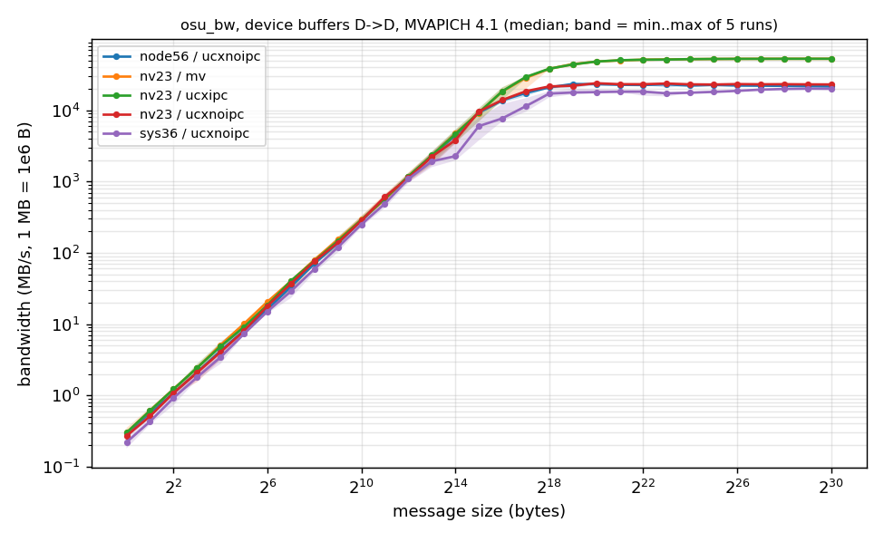

# One page: CUDA-aware MVAPICH + OMB vs NCCL on an 8× RTX A6000 node

**Setup.** One node: 2× EPYC 7713 and 8× RTX A6000, NVLink-bridged in pairs (0–1, 2–3, 4–5, 6–7); everything else goes over PCIe.
Everything was built from source in `$HOME`, without root: UCX 1.22.0 (CUDA), MVAPICH 4.1 (`ch4:ucx`, `--with-cuda`, gforker launcher),
OSU Micro-Benchmarks 7.5.3 (`--enable-cuda`) and nccl-tests 2.21.1 on NCCL 2.21.5. Device buffers were used on both sides.
Every point is the median of 5 interleaved runs, and correctness was checked with OMB `-c` and nccl-tests `#wrong` before timing.
The details and every log path are in `README.md`.

**Three numbers (all MEASURED)**

1. **52,872 MB/s**: MVAPICH 4.1 `osu_bw`, GPU→GPU over NVLink, 1 GiB, min–max 52,870–52,876 (`raw/p2p/osu_bw__nv23__mv__L__rep*.log`).
   With CUDA IPC turned off in UCX (data staged through host memory), the same pair drops to **23,058 MB/s**. The UCX logs confirm the
   transport: `cuda_ipc` zero-copy vs `cuda_copy … frag host`.
2. **43.70 vs 2.28 GB/s bus bandwidth**: NCCL vs MVAPICH 4.1 for a 256 MiB allreduce on that NVLink pair, so NCCL takes 19× less time
   (`results/mpi_vs_nccl_table.csv`). Allgather goes the other way: MVAPICH 43.32 vs NCCL 37.73 GB/s. So moving data is fine;
   the slow part is reducing device data.
3. **16,777,216 of 16,777,216 words wrong**: a 64 MiB CUDA peer copy from GPU 3 to GPU 4 over PCIe with peer access enabled
   (`raw/p2p_probe/probe_3_4_dma.log`). The same probe over NVLink is 100 % correct. This node's IOMMU translates GPU DMA (`DMA-FQ`), and
   NVIDIA says IOMMU-enabled PCIe P2P is unsupported on bare-metal Linux. That probably explains the old "NCCL GPU 0↔2 gives wrong
   allreduce" bug. The probe also left GPU 4 stuck.

**One plot**

*NVLink with IPC (`nv23 / mv`, `nv23 / ucxipc`; the two lines overlap) reaches about 52.9 GB/s. Every host-staged path (`ucxnoipc`:
the same NVLink pair, same-socket 5↔6, cross-socket 3↔6) levels off at about 18–24 GB/s.*

**Three honest limits**

1. **Single node, no working InfiniBand link.** A ConnectX-6 card is installed, but both ports are down (`env/ib_nic.txt`), so
   nothing here covers GPUDirect RDMA or inter-node MPI. And this is open-source MVAPICH 4.1, whose
   changelog calls its GPU support "basic", not MVAPICH-Plus/-GDR.
2. **Cross-pair GPUs were only measured with host staging.** PCIe P2P corrupts data here, so MVAPICH's default GPU path and NCCL's
   default P2P were not run across pairs. The 4-GPU set is one NVLink pair plus two unbridged GPUs (2,3,5,6), not two NVLink pairs.
   GPU 0↔2 was never tested (GPU 0 was busy throughout).
3. **Shared machine.** Another user's jobs kept GPUs 0–1 at 75–100 % throughout, on the same socket as GPUs 2–3. Large sizes used
   10 timed iterations per run, and validation was one 1 B–1 GiB sweep per configuration.

**One open question**

Why does MVAPICH 4.1's device-buffer allreduce over NVLink fall off a cliff between 32 MiB (4,354.92 µs, 7.70 GB/s bus bandwidth) and
64 MiB (29,377.73 µs, 2.28 GB/s), with allgather on the same link running at 43 GB/s? Is it how the reduction is staged (yaksa vs host,
chunk or buffer limits), and does MVAPICH-Plus's GPU path remove it?
