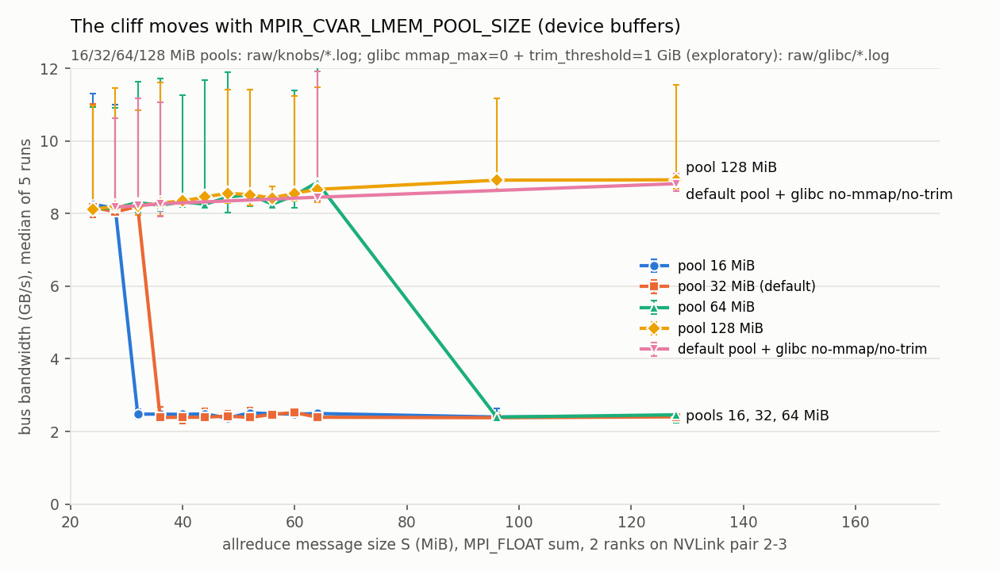

# One page (v2): CUDA-aware MVAPICH + OMB vs NCCL on an 8× RTX A6000 node

*v2, 2026-11-12, adds the follow-up in `followup/`. v1 is unchanged in `ONE_PAGE_SUMMARY.md`.*

**Setup.**
* One node: 2× EPYC 7713 and 8× RTX A6000, NVLink-bridged in pairs (0–1, 2–3, 4–5, 6–7); everything else goes over PCIe.
* Built from source in `$HOME`, without root: UCX 1.22.0 (CUDA), MVAPICH 4.1 (`ch4:ucx`, `--with-cuda`, gforker launcher), OSU
  Micro-Benchmarks 7.5.3 and nccl-tests 2.21.1 on NCCL 2.21.5.
* Device buffers on both sides. Every point is the median of 5 interleaved runs, and every run passed a correctness check.
* The follow-up's hypotheses were committed before it measured (`followup/PREREGISTRATION.md`).

**Three numbers (all MEASURED)**

1. **52,872 MB/s**: MVAPICH 4.1 `osu_bw`, GPU→GPU over NVLink, 1 GiB (`raw/p2p/osu_bw__nv23__mv__L__rep*.log`). With CUDA IPC off in
   UCX it is 23,058 MB/s.
2. **The allreduce cliff starts between 32 and 36 MiB, and moves with MVAPICH's temporary-buffer pool.**
   * Default: 4,079.89 µs at 32 MiB (8.22 GB/s bus bandwidth) vs 15,784.26 µs at 36 MiB (2.39 GB/s) (`followup/raw/sweep/`).
   * Host buffers drop at the same size.
   * All 9 forced allreduce algorithms have a cliff, so it is not an algorithm switch.
   * Raising `MPIR_CVAR_LMEM_POOL_SIZE` from 32 to 128 MiB makes a 128 MiB allreduce **3.7× faster: 55,879.78 → 15,026.16 µs**
     (`followup/raw/knobs/`).
   * Even then, about 8.9 GB/s is far from NCCL's 43.70 GB/s at 256 MiB on the same pair (`results/mpi_vs_nccl_table.csv`).
     Nsight Systems shows why: the reduction runs on the GPU, but half the data makes a round trip through pageable host memory every
     call (`followup/ALLREDUCE_CLIFF.md` §4).
3. **16,777,216 of 16,777,216 words wrong**: a 64 MiB CUDA peer copy from GPU 3 to GPU 4 over PCIe (`raw/p2p_probe/probe_3_4_dma.log`).
   * All 8 GPUs, including the original NCCL bug pair 0 and 2, use the same translated IOMMU mode (`DMA-FQ`, no `iommu=pt`;
     `followup/env/iommu/`).
   * NVIDIA's CUDA Programming Guide §3.4.2.5 says IOMMU-enabled PCIe P2P is unsupported on bare-metal Linux and can silently
     corrupt memory (`followup/IOMMU_EVIDENCE.md`).
   * GPU 4 is still stuck, and the driver now reports `GPU Recovery Action: Reset`.

**One plot**

*16 MiB pool: the cliff is at 28→32 MiB. 32 MiB (default): 32→36. 64 MiB: 64→96. A 128 MiB pool, or glibc with mmap and heap-trimming
turned off (exploratory), removes it up to 128 MiB.*

**Three honest limits**

1. **Single node; MVAPICH 4.1 open source only.** No working InfiniBand link: a ConnectX-6 is installed, but its ports are down. So
   there is no GPUDirect RDMA and no inter-node MPI. 4.1's changelog lists "Basic support for major GPUs". MVAPICH-Plus/GDR was not
   tried.
2. **The PCIe P2P cause is strongly supported but not proven.** I can't read the kernel log or the ACS bits without root. GPU 0↔2 was
   never tested. Cross-pair GPUs were only measured with host staging.
3. **The cliff mechanism is inferred, and the machine is shared.**
   * The pool and glibc experiments, the profile and the source all point to a fresh host temporary buffer on every call.
   * But buffer addresses and page faults were not traced, and only `MPI_FLOAT` on 2 ranks was tested.
   * Another user's jobs ran on GPUs 0–1 throughout, and a few configurations had bimodal run times.
   * Follow-up GPU time: 0.679 GPU-hours.

**One open question (for the lab)**

Is this how MVAPICH 4.1 stages GPU reductions: half the data through a pageable host temporary buffer, with temporary buffers above
`MPIR_CVAR_LMEM_POOL_SIZE` allocated on every call? And does MVAPICH-Plus keep that staging on the device, or in a pinned, reused pool,
which would remove both the cliff and the host round trip?
