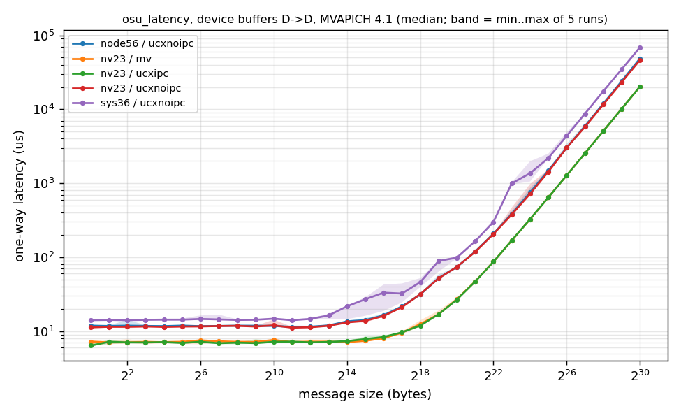
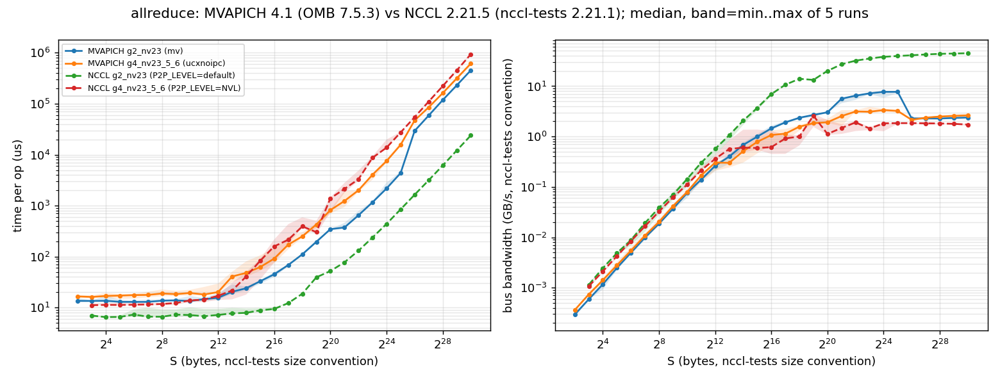
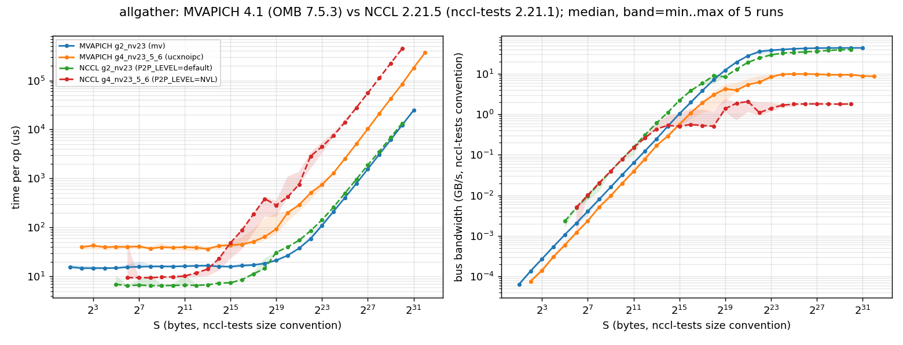
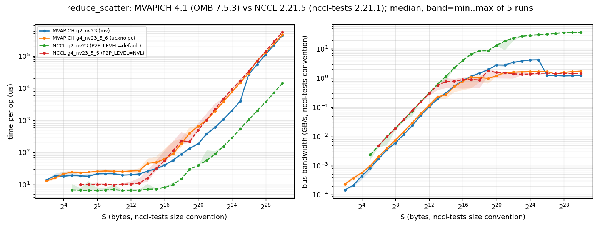
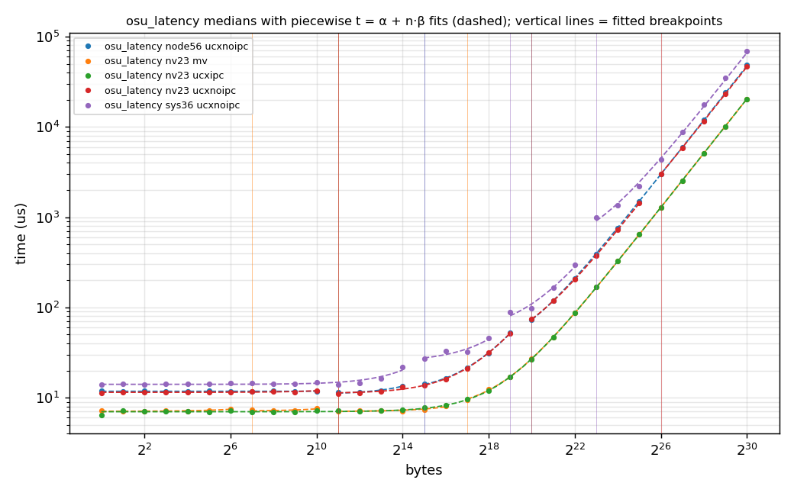
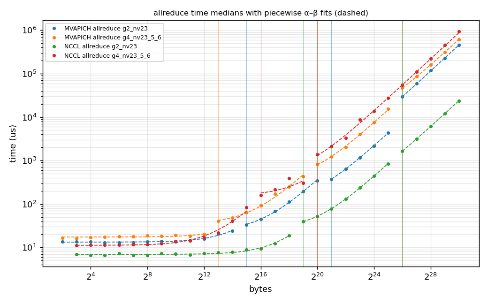

# CUDA-aware MPI (MVAPICH 4.1) + OSU Micro-Benchmarks vs NCCL on 8× RTX A6000

**Goal.** Show, with honest and reproducible numbers, that I can build and use the OSU/MVAPICH toolchain
(CUDA-aware MPI + OSU Micro-Benchmarks) on a real multi-GPU node, and compare it with NCCL (nccl-tests) on the same GPUs.

**Rules this repo follows.** Every number comes from a log in `raw/`, or from a CSV in `results/` that `scripts/analyze.py`
computes from those logs. Every command I ran is in `commands.log` with its timestamp. Claims are labelled **MEASURED** (my logs),
**DOCUMENTED** (official docs, linked; verbatim quotes in `docs/doc_quotes.md`) or **INFERRED** (my interpretation).
Each performance point is the median of 5 runs, with min–max shown, and runs of different configurations were interleaved
in random order (fixed seed). Correctness was checked (OMB `-c`, nccl-tests `#wrong`) before any performance was measured.

> ⚠️ A small CUDA test of PCIe peer-to-peer between GPUs 3 and 4 returned corrupt data and left
> GPU 4 stuck. It needs an administrator reset. The main finding below is the reason: **on this node, PCIe P2P between GPUs that are not
> NVLink-bridged is broken.**

## 1. Findings in one screen

| # | finding | label | evidence |
|---|---|---|---|
| 1 | **PCIe peer-to-peer between non-NVLink GPUs is broken on this node.** With peer access on, every word copied GPU 3→4 was wrong (16777216/16777216 words for 64 MiB), each copy took about 49–53 ms, and the GPU then faulted. GPU 4 has been stuck since. | MEASURED (single diagnostic run, deliberately not repeated) | `raw/p2p_probe/probe_3_4_dma.log` |
| 2 | The IOMMU is in translated mode for every GPU (`DMA-FQ`). NVIDIA: *"CUDA and the NVIDIA driver stack do not support IOMMU-enabled PCIe peer-to-peer memory transfer"* on bare-metal Linux. That most likely also explains the earlier NCCL GPU 0↔2 wrong results. | MEASURED + DOCUMENTED → INFERRED cause | `env/iommu_pcie.txt`, `docs/doc_quotes.md` |
| 3 | NVLink pair 2↔3, MVAPICH 4.1 default path, `osu_bw` 1 GiB: **52,872 MB/s** [52,870–52,876]; `osu_bibw` 1 GiB: **99,978 MB/s**; 1-byte latency **7.24 µs** [6.36–7.41]. All validated with OMB `-c`. | MEASURED | `raw/p2p/osu_bw__nv23__mv__L__rep*.log` |
| 4 | Turning off CUDA IPC in UCX (host staging) on the same NVLink pair: 1 GiB bandwidth drops from 52,876 to **23,058 MB/s**, and 1 MiB latency rises from 26.61 to 74.08 µs. The UCX logs confirm the transport for each case (`cuda_ipc` vs `cuda_copy … frag host`). | MEASURED | `raw/ucx/`, `results/ucx_protocol_selection.md` |
| 5 | NCCL vs MVAPICH, 2 GPUs over NVLink, 256 MiB **allreduce: NCCL 43.70 GB/s busbw vs MVAPICH 2.28 GB/s (19.2× less time)**. Reduce_scatter differs by 30.4×. **Allgather: MVAPICH 43.32 vs NCCL 37.73 GB/s** (MVAPICH faster). | MEASURED | `results/mpi_vs_nccl_table.csv` |
| 6 | MVAPICH 2-GPU allreduce has a cliff between 32 MiB (4,354.92 µs, 7.70 GB/s busbw) and 64 MiB (29,377.73 µs, 2.28 GB/s): 6.7× the time for 2× the data, in all 5 runs. | MEASURED; cause unknown (open question) | `raw/coll/osu_allreduce__g2_nv23__mv__L__rep*.log` |
| 7 | With cross-pair P2P off, the 4-GPU set (2,3 NVLink + 5,6) is host-bound for both libraries. At 256 MiB, MVAPICH (UCX host staging) beats NCCL (`NCCL_P2P_LEVEL=NVL`, SHM/direct for cross-pair hops) on allgather by 9.53 vs 1.80 GB/s busbw. | MEASURED | `results/mpi_vs_nccl_table.csv`, NCCL `via SHM/direct/direct` lines |
| 8 | The fitted α–β breakpoints sit where the libraries switch protocol. NCCL's 512 KiB breakpoint (2 GPUs, all three collectives) is the Ring/LL → Ring/Simple switch in its TUNING log. UCX host staging breaks at 32 KiB and 1 MiB, the first sampled sizes after UCX's own switches at 26067 B and 524289 B. | MEASURED + INFERRED match | `results/fits_*.csv`, `results/nccl_algo_proto_segments.csv`, `results/ucx_protocol_selection.md` |

## 2. P2P correctness findings

**Plan:** validate (i) an NVLink pair, (ii) a cross-pair, (iii) GPU 0↔2.

| path | how data moves | result | evidence |
|---|---|---|---|
| (i) NVLink 2↔3 | MVAPICH default (`mv`, GPU IPC over NVLink) | **validates**: OMB `-c` Pass at every size 1 B–1 GiB for `osu_latency`, `osu_bw`, `osu_bibw` | `raw/validate/osu_*__nv23__mv__V__val__rep*.log` |
| (i) NVLink 2↔3 | UCX `cuda_ipc` (`ucxipc`) and UCX host staging (`ucxnoipc`) | **validates**, all sizes, all three benchmarks | `raw/validate/osu_*__nv23__ucx*__V__val__rep*.log` |
| (i) NVLink 2↔3 | raw CUDA peer copy and peer-load kernel | **correct**: 0 bad words at 4 KiB, 1 MiB and 64 MiB; 51.16 GB/s peer copy | `raw/p2p_probe/probe_2_3_dma.log` |
| (ii) cross-pair 3↔4 (SYS), 5↔6 (NODE) | MVAPICH default path, or UCX `cuda_ipc` (both use CUDA IPC/P2P over PCIe) | **does not work.** Diagnostic single runs: a 1-byte message took about 93.7 ms (93791.80, 93773.82 and 93668.13 µs in three configurations), and messages ≥ 256 KiB did not finish within 40 s. OMB `-c` was **not** run on this path after finding #1 (it can wedge a GPU). | `raw/diag/*.log` |
| (ii) cross-pair 3↔4 | raw CUDA peer copy with peer access enabled | **corrupt**: 1024/1024, 262144/262144 and 16777216/16777216 words wrong, then `unspecified launch failure`, and GPU 4 stuck | `raw/p2p_probe/probe_3_4_dma.log` |
| (ii) cross-pair 3↔4 | raw CUDA copy *without* peer access (driver stages through host) | correct; 8.56 GB/s at 64 MiB | same log |
| (ii) cross-pair 5↔6 (NODE), 3↔6 (SYS) | UCX host staging (`ucxnoipc`) | **validates**, every size 1 B–1 GiB, `osu_latency`, `osu_bw`, `osu_bibw` | `raw/validate/osu_*__{node56,sys36}__ucxnoipc__V__val__*.log` |
| (iii) GPU 0↔2 | — | **NOT RUN.** GPU 0 was busy with another user's job throughout (every pre-run `nvidia-smi` snapshot shows it at 75–100 %). After finding #1 I would not run a P2P test on a GPU someone else is using anyway. | `raw/*/…log` headers |
| NCCL 2-GPU NVLink, 4-GPU with `NCCL_P2P_LEVEL=NVL` | NCCL P2P over NVLink + SHM for cross-pair | **#wrong = 0** in all 30 runs (`-c 1`, every size) | `results/nccl_wrong_summary.csv` |
| NCCL default P2P on a cross-pair | — | **NOT RUN** (deliberately; finding #1 already shows the PCIe P2P path corrupts data) | — |

**Interpretation (INFERRED).** The driver says P2P is available (`nvidia-smi topo -p2p` = OK), so CUDA, UCX `cuda_ipc`, MPICH's GPU IPC and NCCL
all use it. With the AMD IOMMU translating GPU DMA (`DMA-FQ`), peer writes and reads to another GPU's BAR are not delivered correctly.
NVIDIA documents that this configuration is unsupported and can silently corrupt device memory (`docs/doc_quotes.md`). The
`NCCL_P2P_LEVEL=NVL` workaround was correct: it limits P2P to NVLink. The proper fix needs root: IOMMU passthrough/off for the GPUs,
or ACS/IOMMU settings in the BIOS.

## 3. Results

Plots are in `results/plots/`, CSVs in `results/`. All tables below are generated by `scripts/analyze.py` into `results/tables.md`.

### 3.1 Point-to-point (`osu_latency`, `osu_bw`, `osu_bibw`, device buffers on both sides)


*`nv23 / mv` and `nv23 / ucxipc` overlap almost exactly (52,872 vs 52,876 MB/s at 1 GiB), so the orange line is hidden under the green one.*



<!-- generated table copied from results/tables.md -->
Latency in µs (one-way, as OMB reports it); bandwidth in MB/s (OMB's MB = 10^6 bytes).

| benchmark | GPUs | mode | size | median | min–max | n |
|---|---|---|---|---|---|---|
| osu_latency | node56 | ucxnoipc | 1 B | 11.85 | 11.53–12.27 | 5 |
| osu_latency | node56 | ucxnoipc | 8 KiB | 11.94 | 11.86–12.05 | 5 |
| osu_latency | node56 | ucxnoipc | 1 MiB | 73.71 | 72.92–74.33 | 5 |
| osu_latency | node56 | ucxnoipc | 64 MiB | 3,014 | 2,880–3,426 | 5 |
| osu_latency | nv23 | mv | 1 B | 7.24 | 6.36–7.41 | 5 |
| osu_latency | nv23 | mv | 8 KiB | 7.19 | 6.91–7.67 | 5 |
| osu_latency | nv23 | mv | 1 MiB | 26.96 | 26.68–28.22 | 5 |
| osu_latency | nv23 | mv | 64 MiB | 1,280 | 1,278–1,286 | 5 |
| osu_latency | nv23 | ucxipc | 1 B | 6.36 | 6.32–6.79 | 5 |
| osu_latency | nv23 | ucxipc | 8 KiB | 7.15 | 6.94–7.33 | 5 |
| osu_latency | nv23 | ucxipc | 1 MiB | 26.61 | 26.36–26.89 | 5 |
| osu_latency | nv23 | ucxipc | 64 MiB | 1,280 | 1,278–1,286 | 5 |
| osu_latency | nv23 | ucxnoipc | 1 B | 11.26 | 10.78–11.55 | 5 |
| osu_latency | nv23 | ucxnoipc | 8 KiB | 11.81 | 11.60–12.37 | 5 |
| osu_latency | nv23 | ucxnoipc | 1 MiB | 74.08 | 73.40–74.86 | 5 |
| osu_latency | nv23 | ucxnoipc | 64 MiB | 3,029 | 2,925–3,060 | 5 |
| osu_latency | sys36 | ucxnoipc | 1 B | 14.08 | 13.97–14.33 | 5 |
| osu_latency | sys36 | ucxnoipc | 8 KiB | 16.31 | 14.52–17.14 | 5 |
| osu_latency | sys36 | ucxnoipc | 1 MiB | 98.65 | 96.23–102.4 | 5 |
| osu_latency | sys36 | ucxnoipc | 64 MiB | 4,368 | 4,339–4,877 | 5 |
| osu_bw | node56 | ucxnoipc | 8 KiB | 2,271 | 2,208–2,559 | 5 |
| osu_bw | node56 | ucxnoipc | 1 MiB | 23,239 | 22,954–23,639 | 5 |
| osu_bw | node56 | ucxnoipc | 64 MiB | 22,249 | 22,084–22,514 | 5 |
| osu_bw | node56 | ucxnoipc | 1 GiB | 21,584 | 21,472–21,657 | 5 |
| osu_bw | nv23 | mv | 8 KiB | 2,303 | 1,956–2,617 | 5 |
| osu_bw | nv23 | mv | 1 MiB | 48,257 | 47,736–48,371 | 5 |
| osu_bw | nv23 | mv | 64 MiB | 52,720 | 52,716–52,737 | 5 |
| osu_bw | nv23 | mv | 1 GiB | 52,872 | 52,870–52,876 | 5 |
| osu_bw | nv23 | ucxipc | 8 KiB | 2,327 | 1,749–2,642 | 5 |
| osu_bw | nv23 | ucxipc | 1 MiB | 48,296 | 48,011–48,360 | 5 |
| osu_bw | nv23 | ucxipc | 64 MiB | 52,719 | 52,671–52,724 | 5 |
| osu_bw | nv23 | ucxipc | 1 GiB | 52,876 | 52,861–52,877 | 5 |
| osu_bw | nv23 | ucxnoipc | 8 KiB | 2,237 | 1,678–2,558 | 5 |
| osu_bw | nv23 | ucxnoipc | 1 MiB | 23,987 | 23,052–24,198 | 5 |
| osu_bw | nv23 | ucxnoipc | 64 MiB | 23,322 | 23,217–23,455 | 5 |
| osu_bw | nv23 | ucxnoipc | 1 GiB | 23,058 | 23,005–23,130 | 5 |
| osu_bw | sys36 | ucxnoipc | 8 KiB | 1,927 | 1,593–2,313 | 5 |
| osu_bw | sys36 | ucxnoipc | 1 MiB | 17,985 | 17,438–19,847 | 5 |
| osu_bw | sys36 | ucxnoipc | 64 MiB | 18,727 | 18,631–18,938 | 5 |
| osu_bw | sys36 | ucxnoipc | 1 GiB | 20,035 | 19,897–20,354 | 5 |
| osu_bibw | node56 | ucxnoipc | 1 MiB | 27,344 | 26,651–27,807 | 5 |
| osu_bibw | node56 | ucxnoipc | 64 MiB | 26,140 | 25,444–26,312 | 5 |
| osu_bibw | node56 | ucxnoipc | 1 GiB | 19,971 | 19,420–20,637 | 5 |
| osu_bibw | nv23 | mv | 1 MiB | 91,220 | 89,903–92,135 | 5 |
| osu_bibw | nv23 | mv | 64 MiB | 99,721 | 99,674–99,725 | 5 |
| osu_bibw | nv23 | mv | 1 GiB | 99,978 | 99,977–99,980 | 5 |
| osu_bibw | sys36 | ucxnoipc | 1 MiB | 17,508 | 17,443–18,334 | 5 |
| osu_bibw | sys36 | ucxnoipc | 64 MiB | 17,035 | 16,982–17,105 | 5 |
| osu_bibw | sys36 | ucxnoipc | 1 GiB | 15,695 | 15,623–15,820 | 5 |

**NVLink headroom (INFERRED).** `nvidia-smi nvlink -s` reports 4 links × 14.062 GB/s per GPU. If that is per direction, the 52,872 MB/s
measured is about 94 % of a 56.25 GB/s peak.

### 3.2 UCX transport contrast (NVLink pair 2↔3, intra-node traffic forced through ch4:ucx with `MPIR_CVAR_NOLOCAL=1`)

| UCX_TLS | `osu_latency` 1 B (µs) | `osu_latency` 1 MiB (µs) | `osu_bw` 1 MiB (MB/s) | `osu_bw` 1 GiB (MB/s) |
|---|---|---|---|---|
| `self,sm,cuda_copy,cuda_ipc` | 6.36 [6.32–6.79] | 26.61 [26.36–26.89] | 48,296 [48,011–48,360] | 52,876 [52,861–52,877] |
| `self,sm,cuda_copy` (CUDA IPC off) | 11.26 [10.78–11.55] | 74.08 [73.40–74.86] | 23,987 [23,052–24,198] | 23,058 [23,005–23,130] |

(Median [min–max] of 5 runs. The values are copied from the generated point-to-point table above, rows `nv23 / ucxipc` and `nv23 / ucxnoipc`.)

**Which transport really carried the data (MEASURED, `UCX_LOG_LEVEL=info UCX_PROTO_INFO=y`, one extra run per mode):**

<!-- copied from results/ucx_protocol_selection.md -->

#### osu_bw__node56__ucxnoipc__S__ucxlog  (`raw/ucxlog/osu_bw__node56__ucxnoipc__S__ucxlog__rep1.log`)

UCX endpoint config: `intra-node cfg#1 tag(sysv/memory cma/memory)`; `intra-node cfg#2 tag(sysv/memory cma/memory)`

```
| tagged message by ucp_tag_send*(multi) from cuda/GPU0                                                                   |
|    1..26066 | (?) rendezvous cuda_copy, copy to attached, frag host, cuda_copy, frag host                 |             |
| 26067..512K | (?) rendezvous cuda_copy, flushed write to remote, frag host, cuda_copy, frag host          | cma/memory  |
| 524289..inf | (?) rendezvous pipeline cuda_copy, flushed write to remote, frag host, cuda_copy, frag host | cma/memory  |
```

#### osu_bw__nv23__ucxipc__S__ucxlog  (`raw/ucxlog/osu_bw__nv23__ucxipc__S__ucxlog__rep1.log`)

UCX endpoint config: `intra-node cfg#1 tag(sysv/memory cma/memory cuda_ipc/cuda)`; `intra-node cfg#2 tag(sysv/memory cma/memory cuda_ipc/cuda)`

```
| tagged message by ucp_tag_send*(multi) from cuda/GPU0              |
| 1..inf | (?) rendezvous zero-copy read from remote | cuda_ipc/cuda |
```

#### osu_bw__nv23__ucxnoipc__S__ucxlog  (`raw/ucxlog/osu_bw__nv23__ucxnoipc__S__ucxlog__rep1.log`)

UCX endpoint config: `intra-node cfg#1 tag(sysv/memory cma/memory)`; `intra-node cfg#2 tag(sysv/memory cma/memory)`

```
| tagged message by ucp_tag_send*(multi) from cuda/GPU0                                                                   |
|    1..26066 | (?) rendezvous cuda_copy, copy to attached, frag host, cuda_copy, frag host                 |             |
| 26067..512K | (?) rendezvous cuda_copy, flushed write to remote, frag host, cuda_copy, frag host          | cma/memory  |
| 524289..inf | (?) rendezvous pipeline cuda_copy, flushed write to remote, frag host, cuda_copy, frag host | cma/memory  |
```


So with `cuda_ipc` allowed, UCX uses a single protocol for all sizes: rendezvous zero-copy read through `cuda_ipc`. Without it, every
device message is staged through host memory (`frag host`), and above 512 KiB it uses the `pipeline` variant. A single α–β segment fits
`nv23 ucxipc` over 1 B–1 GiB (α = 6.99 µs, 1/β = 52.69 GB/s), which is consistent with that single protocol.

### 3.3 Collectives: MVAPICH 4.1 (OMB) vs NCCL 2.21.5 (nccl-tests), 2 GPUs (`g2_nv23`) and 4 GPUs (`g4_nv23_5_6`)





<!-- generated table copied from results/tables.md -->
S = bytes in the nccl-tests convention. busbw = S/t × (2(n−1)/n for allreduce, (n−1)/n otherwise).

| S | collective | GPUs | MPI mode | MPI time µs | MPI busbw GB/s | NCCL time µs | NCCL busbw GB/s | MPI time / NCCL time |
|---|---|---|---|---|---|---|---|---|
| 8 KiB | allreduce | g2_nv23 | mv | 20.49 [18.50–28.56] | 0.40 | 7.73 [7.35–9.94] | 1.06 | 2.65 |
| 8 KiB | allreduce | g4_nv23_5_6 | ucxnoipc | 40.87 [31.68–50.55] | 0.30 | 21.73 [14.56–31.06] | 0.57 | 1.88 |
| 8 KiB | allgather | g2_nv23 | mv | 16.59 [15.82–17.52] | 0.25 | 6.74 [6.69–7.05] | 0.61 | 2.46 |
| 8 KiB | allgather | g4_nv23_5_6 | ucxnoipc | 36.33 [35.83–39.69] | 0.17 | 14.09 [10.10–14.59] | 0.44 | 2.58 |
| 8 KiB | reduce_scatter | g2_nv23 | mv | 21.13 [19.06–23.88] | 0.19 | 6.61 [6.56–6.95] | 0.62 | 3.20 |
| 8 KiB | reduce_scatter | g4_nv23_5_6 | ucxnoipc | 26.93 [22.70–31.73] | 0.23 | 11.01 [10.47–15.71] | 0.56 | 2.45 |
| 1 MiB | allreduce | g2_nv23 | mv | 346.9 [328.4–348.9] | 3.02 | 52.25 [52.18–52.35] | 20.07 | 6.64 |
| 1 MiB | allreduce | g4_nv23_5_6 | ucxnoipc | 819.0 [700.9–845.0] | 1.92 | 1,397 [741.4–1,455] | 1.13 | 0.59 |
| 1 MiB | allgather | g2_nv23 | mv | 26.87 [25.48–27.44] | 19.51 | 40.05 [39.99–40.20] | 13.09 | 0.67 |
| 1 MiB | allgather | g4_nv23_5_6 | ucxnoipc | 199.7 [130.6–219.4] | 3.94 | 418.1 [401.6–1,094] | 1.88 | 0.48 |
| 1 MiB | reduce_scatter | g2_nv23 | mv | 185.2 [184.0–199.1] | 2.83 | 39.46 [39.23–39.66] | 13.29 | 4.69 |
| 1 MiB | reduce_scatter | g4_nv23_5_6 | ucxnoipc | 648.8 [613.7–671.0] | 1.21 | 500.1 [460.3–810.7] | 1.57 | 1.30 |
| 256 MiB | allreduce | g2_nv23 | mv | 117,960 [112,858–121,135] | 2.28 | 6,143 [6,115–6,152] | 43.70 | 19.20 |
| 256 MiB | allreduce | g4_nv23_5_6 | ucxnoipc | 161,430 [155,442–168,672] | 2.49 | 221,717 [218,710–230,244] | 1.82 | 0.73 |
| 256 MiB | allgather | g2_nv23 | mv | 3,099 [3,097–3,100] | 43.32 | 3,557 [3,554–3,575] | 37.73 | 0.87 |
| 256 MiB | allgather | g4_nv23_5_6 | ucxnoipc | 21,117 [20,809–21,377] | 9.53 | 111,806 [111,372–113,539] | 1.80 | 0.19 |
| 256 MiB | reduce_scatter | g2_nv23 | mv | 112,033 [107,481–113,922] | 1.20 | 3,686 [3,640–3,733] | 36.41 | 30.39 |
| 256 MiB | reduce_scatter | g4_nv23_5_6 | ucxnoipc | 127,198 [124,457–130,117] | 1.58 | 140,290 [137,568–145,858] | 1.44 | 0.91 |

**How each library moved data (MEASURED, NCCL INFO lines).** On `g2_nv23`, NCCL connects 2↔3 `via P2P/CUMEM`. On `g4_nv23_5_6` with
`NCCL_P2P_LEVEL=NVL`, the ring is 2→3 `via P2P/CUMEM` and 3→5, 5→6, 6→2 `via SHM/direct/direct` (`raw/nccl/*g4*.log`).
NCCL picked **Ring/LL for S ≤ 256 KiB and Ring/Simple for S ≥ 512 KiB** in all six configurations. It never picked LL128 or Tree
(`results/nccl_algo_proto_segments.csv`). MVAPICH ran 2-GPU collectives on its default path and 4-GPU collectives with UCX host staging
(`ucxnoipc`), because its default path would put traffic on the broken PCIe P2P between pairs.

**Reading the numbers (INFERRED).**
* Small messages: NCCL takes about 6.6–7.7 µs per 2-GPU collective at 8 KiB vs MVAPICH's 16.6–21.1 µs.
* Large NVLink allreduce/reduce_scatter: MVAPICH is 19–30× slower, but its allgather is as fast as NCCL's or faster. So the bottleneck is
  the reduction path for device buffers, not data movement. In MVAPICH 4.1, yaksa-based reduction is enabled
  (`MPIR_CVAR_ENABLE_YAKSA_REDUCTION=1`, `raw/verify/mvapich_mpivars.txt`), so this is not the simple "swap to host buffers" path in
  `src/mpi/coll/mpir_coll.c`. I did not profile further.
* 4 GPUs without cross-pair P2P: both libraries are bound by host-memory staging. NCCL's SHM transport was slower than UCX's pipelined
  `cuda_copy` staging here.

### 3.4 α–β fits and protocol breakpoints




<!-- generated table copied from results/tables.md -->
| curve | segment | pts | α (µs) ± SE | β (µs/B) ± SE | 1/β (GB/s) | rel. RMS err |
|---|---|---|---|---|---|---|
| osu_latency node56 ucxnoipc | 1 B–1 KiB | 11 | 11.78 ± 0.03 | 1.567e-05 ± 7.6e-05 | 63.80 | 0.6% |
| osu_latency node56 ucxnoipc | 2 KiB–16 KiB | 4 | 10.91 ± 0.18 | 1.521e-04 ± 2.1e-05 | 6.57 | 1.3% |
| osu_latency node56 ucxnoipc | 32 KiB–512 KiB | 5 | 11.48 ± 0.14 | 7.670e-05 ± 1.1e-06 | 13.04 | 0.9% |
| osu_latency node56 ucxnoipc | 1 MiB–1 GiB | 11 | 26.60 ± 1.20 | 4.403e-05 ± 2.9e-07 | 22.71 | 1.6% |
| osu_latency nv23 mv | 1 B–64 B | 7 | 7.07 ± 0.05 | 5.901e-03 ± 1.9e-03 | 0.17 | 1.2% |
| osu_latency nv23 mv | 128 B–1 KiB | 4 | 7.10 ± 0.15 | 4.118e-04 ± 2.6e-04 | 2.43 | 1.7% |
| osu_latency nv23 mv | 2 KiB–64 KiB | 6 | 7.04 ± 0.07 | 1.362e-05 ± 2.3e-06 | 73.40 | 1.3% |
| osu_latency nv23 mv | 128 KiB–1 GiB | 14 | 7.16 ± 0.07 | 1.897e-05 ± 6.1e-08 | 52.71 | 0.9% |
| osu_latency nv23 ucxipc | 1 B–1 GiB | 31 | 6.99 ± 0.04 | 1.898e-05 ± 1.3e-07 | 52.69 | 2.2% |
| osu_latency nv23 ucxnoipc | 1 B–1 KiB | 11 | 11.48 ± 0.05 | 4.551e-04 ± 1.4e-04 | 2.20 | 1.1% |
| osu_latency nv23 ucxnoipc | 2 KiB–512 KiB | 9 | 11.18 ± 0.12 | 7.721e-05 ± 1.6e-06 | 12.95 | 2.0% |
| osu_latency nv23 ucxnoipc | 1 MiB–32 MiB | 6 | 30.69 ± 0.50 | 4.148e-05 ± 1.7e-07 | 24.11 | 0.5% |
| osu_latency nv23 ucxnoipc | 64 MiB–1 GiB | 5 | 133.0 ± 36.40 | 4.286e-05 ± 2.7e-07 | 23.33 | 0.7% |
| osu_latency sys36 ucxnoipc | 1 B–16 KiB | 15 | 14.06 ± 0.15 | 3.750e-04 ± 4.2e-05 | 2.67 | 3.4% |
| osu_latency sys36 ucxnoipc | 32 KiB–256 KiB | 4 | 25.23 ± 2.46 | 7.331e-05 ± 2.0e-05 | 13.64 | 6.5% |
| osu_latency sys36 ucxnoipc | 512 KiB–4 MiB | 4 | 52.19 ± 10.85 | 5.469e-05 ± 8.0e-06 | 18.29 | 7.7% |
| osu_latency sys36 ucxnoipc | 8 MiB–1 GiB | 8 | 396.0 ± 63.59 | 6.124e-05 ± 2.1e-06 | 16.33 | 6.1% |

<!-- generated table copied from results/tables.md -->
| curve | segment | pts | α (µs) ± SE | β (µs/B) ± SE | 1/β (GB/s) | rel. RMS err |
|---|---|---|---|---|---|---|
| MVAPICH allgather g2_nv23 | 2 B–128 B | 7 | 14.90 ± 0.18 | 6.092e-03 ± 3.3e-03 | 0.16 | 2.0% |
| MVAPICH allgather g2_nv23 | 256 B–8 KiB | 6 | 15.94 ± 0.05 | 8.655e-05 ± 1.2e-05 | 11.55 | 0.4% |
| MVAPICH allgather g2_nv23 | 16 KiB–4 MiB | 9 | 15.78 ± 0.06 | 1.037e-05 ± 9.2e-08 | 96.42 | 0.7% |
| MVAPICH allgather g2_nv23 | 8 MiB–2 GiB | 9 | 14.03 ± 1.06 | 1.153e-05 ± 4.5e-08 | 86.76 | 0.8% |
| MVAPICH allgather g4_nv23_5_6 | 4 B–512 KiB | 18 | 39.23 ± 0.43 | 9.922e-05 ± 5.7e-06 | 10.08 | 3.9% |
| MVAPICH allgather g4_nv23_5_6 | 1 MiB–8 MiB | 4 | 119.8 ± 19.46 | 8.056e-05 ± 7.7e-06 | 12.41 | 5.8% |
| MVAPICH allgather g4_nv23_5_6 | 16 MiB–4 GiB | 9 | -93.02 ± 58.03 | 8.017e-05 ± 1.4e-06 | 12.47 | 3.7% |
| MVAPICH allreduce g2_nv23 | 4 B–16 KiB | 13 | 13.26 ± 0.15 | 6.970e-04 ± 4.4e-05 | 1.43 | 3.2% |
| MVAPICH allreduce g2_nv23 | 32 KiB–1 MiB | 6 | 23.43 ± 1.13 | 3.243e-04 ± 8.8e-06 | 3.08 | 3.1% |
| MVAPICH allreduce g2_nv23 | 2 MiB–32 MiB | 5 | 113.0 ± 6.60 | 1.253e-04 ± 1.4e-06 | 7.98 | 1.2% |
| MVAPICH allreduce g2_nv23 | 64 MiB–1 GiB | 5 | 952.2 ± 634.7 | 4.268e-04 ± 4.8e-06 | 2.34 | 1.3% |
| MVAPICH allreduce g4_nv23_5_6 | 4 B–4 KiB | 11 | 17.36 ± 0.30 | 7.242e-04 ± 2.3e-04 | 1.38 | 4.4% |
| MVAPICH allreduce g4_nv23_5_6 | 8 KiB–512 KiB | 7 | 35.20 ± 2.68 | 8.306e-04 ± 5.0e-05 | 1.20 | 7.4% |
| MVAPICH allreduce g4_nv23_5_6 | 1 MiB–32 MiB | 6 | 342.1 ± 40.92 | 4.316e-04 ± 1.3e-05 | 2.32 | 4.0% |
| MVAPICH allreduce g4_nv23_5_6 | 64 MiB–1 GiB | 5 | 9,070 ± 293.4 | 5.661e-04 ± 2.0e-06 | 1.77 | 0.4% |
| MVAPICH reduce_scatter g2_nv23 | 4 B–32 B | 4 | 14.62 ± 1.93 | 1.684e-01 ± 1.2e-01 | 0.01 | 10.1% |
| MVAPICH reduce_scatter g2_nv23 | 64 B–256 KiB | 13 | 19.77 ± 0.45 | 2.814e-04 ± 1.6e-05 | 3.55 | 6.0% |
| MVAPICH reduce_scatter g2_nv23 | 512 KiB–32 MiB | 7 | 71.85 ± 9.24 | 1.199e-04 ± 5.0e-06 | 8.34 | 6.3% |
| MVAPICH reduce_scatter g2_nv23 | 64 MiB–1 GiB | 5 | -635.8 ± 461.7 | 4.124e-04 ± 3.6e-06 | 2.43 | 1.0% |
| MVAPICH reduce_scatter g4_nv23_5_6 | 4 B–32 B | 4 | 11.94 ± 1.33 | 4.372e-01 ± 9.6e-02 | 0.00 | 7.2% |
| MVAPICH reduce_scatter g4_nv23_5_6 | 64 B–8 KiB | 8 | 24.98 ± 0.43 | 2.723e-04 ± 1.4e-04 | 3.67 | 3.3% |
| MVAPICH reduce_scatter g4_nv23_5_6 | 16 KiB–256 KiB | 5 | 33.79 ± 4.44 | 4.918e-04 ± 6.7e-05 | 2.03 | 8.7% |
| MVAPICH reduce_scatter g4_nv23_5_6 | 512 KiB–1 GiB | 12 | 158.7 ± 23.72 | 4.464e-04 ± 1.0e-05 | 2.24 | 6.1% |
| NCCL allgather g2_nv23 | 32 B–256 KiB | 14 | 6.56 ± 0.06 | 3.171e-05 ± 1.2e-06 | 31.53 | 2.5% |
| NCCL allgather g2_nv23 | 512 KiB–64 MiB | 8 | 24.36 ± 0.44 | 1.415e-05 ± 1.4e-07 | 70.68 | 1.6% |
| NCCL allgather g2_nv23 | 128 MiB–1 GiB | 4 | 219.0 ± 14.35 | 1.238e-05 ± 5.9e-08 | 80.75 | 0.4% |
| NCCL allgather g4_nv23_5_6 | 64 B–8 KiB | 8 | 9.30 ± 0.07 | 5.753e-04 ± 2.6e-05 | 1.74 | 1.3% |
| NCCL allgather g4_nv23_5_6 | 16 KiB–128 KiB | 4 | 0.58 ± 1.64 | 1.389e-03 ± 5.7e-05 | 0.72 | 3.4% |
| NCCL allgather g4_nv23_5_6 | 256 KiB–2 MiB | 4 | 232.7 ± 84.42 | 2.045e-04 ± 1.0e-04 | 4.89 | 17.5% |
| NCCL allgather g4_nv23_5_6 | 4 MiB–1 GiB | 9 | 1,085 ± 88.75 | 4.038e-04 ± 5.9e-06 | 2.48 | 3.0% |
| NCCL allreduce g2_nv23 | 8 B–256 KiB | 16 | 6.92 ± 0.09 | 4.389e-05 ± 2.4e-06 | 22.79 | 4.2% |
| NCCL allreduce g2_nv23 | 512 KiB–32 MiB | 7 | 26.38 ± 0.35 | 2.472e-05 ± 1.5e-07 | 40.45 | 0.9% |
| NCCL allreduce g2_nv23 | 64 MiB–1 GiB | 5 | 154.4 ± 12.15 | 2.222e-05 ± 8.9e-08 | 45.00 | 0.5% |
| NCCL allreduce g4_nv23_5_6 | 8 B–32 KiB | 13 | 11.18 ± 0.33 | 1.745e-03 ± 1.2e-04 | 0.57 | 7.5% |
| NCCL allreduce g4_nv23_5_6 | 64 KiB–512 KiB | 4 | 155.4 ± 47.78 | 3.591e-04 ± 2.1e-04 | 2.79 | 20.6% |
| NCCL allreduce g4_nv23_5_6 | 1 MiB–1 GiB | 11 | 453.3 ± 106.2 | 8.169e-04 ± 2.6e-05 | 1.22 | 7.7% |
| NCCL reduce_scatter g2_nv23 | 32 B–16 KiB | 10 | 6.62 ± 0.06 | 2.212e-05 ± 1.0e-05 | 45.22 | 2.0% |
| NCCL reduce_scatter g2_nv23 | 32 KiB–256 KiB | 4 | 5.96 ± 0.30 | 3.287e-05 ± 2.8e-06 | 30.42 | 2.9% |
| NCCL reduce_scatter g2_nv23 | 512 KiB–32 MiB | 7 | 22.35 ± 0.34 | 1.570e-05 ± 1.3e-07 | 63.71 | 1.1% |
| NCCL reduce_scatter g2_nv23 | 64 MiB–1 GiB | 5 | 172.9 ± 14.76 | 1.315e-05 ± 1.0e-07 | 76.06 | 0.9% |
| NCCL reduce_scatter g4_nv23_5_6 | 64 B–8 KiB | 8 | 9.79 ± 0.06 | 1.402e-04 ± 1.8e-05 | 7.13 | 1.1% |
| NCCL reduce_scatter g4_nv23_5_6 | 16 KiB–256 KiB | 5 | 2.43 ± 0.74 | 8.384e-04 ± 2.2e-05 | 1.19 | 2.8% |
| NCCL reduce_scatter g4_nv23_5_6 | 512 KiB–16 MiB | 6 | -71.50 ± 8.47 | 5.479e-04 ± 8.8e-06 | 1.83 | 2.4% |
| NCCL reduce_scatter g4_nv23_5_6 | 32 MiB–1 GiB | 6 | -437.2 ± 158.4 | 5.198e-04 ± 2.3e-06 | 1.92 | 0.6% |

**Matching breakpoints to documented switches:**

| curve | fitted breakpoints (first size of each new segment) | documented / logged switch | match? |
|---|---|---|---|
| NCCL allreduce, allgather, reduce_scatter `g2_nv23` | 512 KiB in all three (others: allreduce 64 MiB; allgather 128 MiB; reduce_scatter 32 KiB and 64 MiB) | Ring/LL → Ring/Simple at 512 KiB (`results/nccl_algo_proto_segments.csv`) | 512 KiB yes; the others are not protocol switches |
| UCX host staging `node56` | 2 KiB, 32 KiB, 1 MiB | UCX tag-send protocol switches at 26067 B and 524289 B (`results/ucx_protocol_selection.md`) | 32 KiB and 1 MiB yes; 2 KiB not explained |
| UCX host staging `nv23` | 2 KiB, 1 MiB, 64 MiB | same UCX switches | 1 MiB yes; 2 KiB and 64 MiB not explained |
| UCX `cuda_ipc` `nv23` | none (one segment) | one protocol 1..inf (`cuda_ipc` rendezvous) | yes |
| MVAPICH default `nv23` | 128 B, 2 KiB, 128 KiB; α ≈ 7.0–7.2 µs in every segment | `GPU_FAST_COPY_MAX_SIZE=4096`, `CH4_IPC_GPU_P2P_THRESHOLD=1048576`, `CH4_IPC_MAP_REPEAT_ADDR=1` (`raw/verify/mvapich_mpivars.txt`) | no clear match. INFERRED: because OMB reuses one buffer, MAP_REPEAT_ADDR puts even small messages on the IPC path, so the 1 MiB threshold never shows |

Caveats on the fits:
* "Eager vs rendezvous" in MVAPICH's default path is not visible as a single breakpoint here; the table above gives what is.
* α on the largest segments (64 MiB+) is an intercept extrapolated far from the data. Some are negative, with large standard errors.
  Only β (the bandwidth term) means anything there.
* 15 fitted segments have a relative RMS error above 5 % (the largest is 20.6 %, NCCL allreduce on 4 GPUs, 64 KiB–512 KiB). They are
  mostly the noisy 4-GPU host-staged curves, MVAPICH reduce_scatter and cross-socket `sys36` latency. A straight α + n·β line is a poor
  model there.

### 3.5 Validation details

<!-- generated table copied from results/tables.md -->
| benchmark | GPUs | mode | sizes validated | #sizes | Pass | Fail | abnormal exit | log |
|---|---|---|---|---|---|---|---|---|
| osu_allgather | g2_nv23 | mv | 1 B–1 GiB | 31 | 31 | 0 | no | `raw/validate/osu_allgather__g2_nv23__mv__V__val__rep1.log` |
| osu_allgather | g4_nv23_5_6 | ucxnoipc | 1 B–512 MiB | 30 | 30 | 0 | **yes: ranks aborted after last size** | `raw/validate/osu_allgather__g4_nv23_5_6__ucxnoipc__V__val__rep1.log` |
| osu_allreduce | g2_nv23 | mv | 4 B–1 GiB | 29 | 29 | 0 | no | `raw/validate/osu_allreduce__g2_nv23__mv__V__val__rep2.log` |
| osu_allreduce | g4_nv23_5_6 | ucxnoipc | 4 B–1 GiB | 29 | 29 | 0 | no | `raw/validate/osu_allreduce__g4_nv23_5_6__ucxnoipc__V__val__rep2.log` |
| osu_bibw | node56 | ucxnoipc | 1 B–1 GiB | 31 | 31 | 0 | no | `raw/validate/osu_bibw__node56__ucxnoipc__V__val__rep2.log` |
| osu_bibw | nv23 | mv | 1 B–1 GiB | 31 | 31 | 0 | no | `raw/validate/osu_bibw__nv23__mv__V__val__rep1.log` |
| osu_bibw | nv23 | ucxipc | 1 B–1 GiB | 31 | 31 | 0 | no | `raw/validate/osu_bibw__nv23__ucxipc__V__val__rep1.log` |
| osu_bibw | nv23 | ucxnoipc | 1 B–1 GiB | 31 | 31 | 0 | no | `raw/validate/osu_bibw__nv23__ucxnoipc__V__val__rep1.log` |
| osu_bibw | sys36 | ucxnoipc | 1 B–1 GiB | 31 | 31 | 0 | no | `raw/validate/osu_bibw__sys36__ucxnoipc__V__val__rep2.log` |
| osu_bw | node56 | ucxnoipc | 1 B–1 GiB | 31 | 31 | 0 | no | `raw/validate/osu_bw__node56__ucxnoipc__V__val__rep2.log` |
| osu_bw | nv23 | mv | 1 B–1 GiB | 31 | 31 | 0 | no | `raw/validate/osu_bw__nv23__mv__V__val__rep1.log` |
| osu_bw | nv23 | ucxipc | 1 B–1 GiB | 31 | 31 | 0 | no | `raw/validate/osu_bw__nv23__ucxipc__V__val__rep1.log` |
| osu_bw | nv23 | ucxnoipc | 1 B–1 GiB | 31 | 31 | 0 | no | `raw/validate/osu_bw__nv23__ucxnoipc__V__val__rep1.log` |
| osu_bw | sys36 | ucxnoipc | 1 B–1 GiB | 31 | 31 | 0 | no | `raw/validate/osu_bw__sys36__ucxnoipc__V__val__rep1.log` |
| osu_latency | node56 | ucxnoipc | 1 B–1 GiB | 31 | 31 | 0 | no | `raw/validate/osu_latency__node56__ucxnoipc__V__val__rep2.log` |
| osu_latency | nv23 | mv | 1 B–1 GiB | 31 | 31 | 0 | no | `raw/validate/osu_latency__nv23__mv__V__val__rep2.log` |
| osu_latency | nv23 | ucxipc | 1 B–1 GiB | 31 | 31 | 0 | no | `raw/validate/osu_latency__nv23__ucxipc__V__val__rep2.log` |
| osu_latency | nv23 | ucxnoipc | 1 B–1 GiB | 31 | 31 | 0 | no | `raw/validate/osu_latency__nv23__ucxnoipc__V__val__rep1.log` |
| osu_latency | sys36 | ucxnoipc | 1 B–1 GiB | 31 | 31 | 0 | no | `raw/validate/osu_latency__sys36__ucxnoipc__V__val__rep2.log` |
| osu_reduce_scatter | g2_nv23 | mv | 4 B–1 GiB | 29 | 29 | 0 | no | `raw/validate/osu_reduce_scatter__g2_nv23__mv__V__val__rep1.log` |
| osu_reduce_scatter | g4_nv23_5_6 | ucxnoipc | 4 B–1 GiB | 29 | 29 | 0 | no | `raw/validate/osu_reduce_scatter__g4_nv23_5_6__ucxnoipc__V__val__rep1.log` |

The `g4_nv23_5_6` allgather validation run aborted (`munmap_chunk(): invalid pointer`, all 4 ranks) **after** its 512 MiB-per-rank size had
passed. So the 1 GiB-per-rank allgather point on 4 GPUs is **measured but not validated**. INFERRED: probably an OMB validation-buffer
problem at 4 GiB total (1 GiB × 4 ranks); the matching measurement runs without `-c` completed normally. gforker's `mpiexec` returned
exit code 0 for that run. `campaign.py` and `analyze.py` now also check the log for `signaled with`; no other log contains it.

### 3.6 GPU time

<!-- generated table copied from results/tables.md -->
| phase | runs | wall minutes | GPU-hours (wall × #GPUs) |
|---|---|---|---|
| coll | 60 | 10.6 | 0.57 |
| nccl | 30 | 20.3 | 1.29 |
| p2p | 90 | 20.7 | 0.69 |
| smoke | 1 | 0.1 | 0.00 |
| ucx | 40 | 6.4 | 0.21 |
| ucxlog | 3 | 0.2 | 0.01 |
| validate | 22 | 36.8 | 1.46 |
| diag | 16 | 10.9 | 0.36 |
| p2p_probe | 4 | 2.7 | 0.09 |
| manual hung osu_bw GPUs 3+4 (from commands.log) | 1 | 5.0 | 0.17 |
| TOTAL (logged runs) | 267 | 113.7 | 4.86 |

*Wall-clock GPU occupancy* for all logged runs was **113.7 min**. Add a few unlogged checks of seconds each: the CUDA-aware probe, a 6 s
listener check, `osu_latency --help`, and one NCCL smoke run. That stays under the 2-hour budget, but only just. **Counted as GPU-hours**
(wall × number of GPUs) it is **4.86 GPU-hours**. If the budget meant GPU-hours, I exceeded it. The largest cost was validation at
36.8 wall-minutes; OMB's host-side checking of 1 GiB buffers is slow.


## 4. Hardware and topology (MEASURED, `env/`)

| item | value | source |
|---|---|---|
| node | `node`, Ubuntu 24.04.5 LTS, kernel 7.0.0-38-generic | `env/os_driver.txt` |
| CPUs | 2 × AMD EPYC 7713 (64 cores, 2 threads/core per socket), 2 NUMA nodes, ~990 GB RAM | `env/lscpu.txt`, `env/numactl_H.txt` |
| NUMA | node 0: CPUs 0-63,128-191 · node 1: CPUs 64-127,192-255 (distance 10/32) | `env/numactl_H.txt` |
| GPUs | 8 × NVIDIA RTX A6000, 49140 MiB, PCIe Gen4 x16 each | `env/nvidia-smi_q.txt` |
| NVLink | 4 links per GPU, 14.062 GB/s each, as bridged pairs | `env/nvidia-smi_nvlink_s.txt` |
| driver | 580.178.04 (CUDA driver API 13.0) | `env/nvidia-smi.txt` |
| IOMMU | AMD IOMMU on (`ivhd0`–`ivhd7`); every GPU's IOMMU group is in translated mode `DMA-FQ`; no `iommu=pt` on the kernel command line | `env/iommu_pcie.txt` |

**Topology** (`env/nvidia-smi_topo.txt`). The "believed" pairing is correct:

```
          GPU0 GPU1 GPU2 GPU3 GPU4 GPU5 GPU6 GPU7   NUMA
   GPU0    X   NV4  NODE NODE SYS  SYS  SYS  SYS     0
   GPU1   NV4   X   NODE NODE SYS  SYS  SYS  SYS     0
   GPU2   NODE NODE  X   NV4  SYS  SYS  SYS  SYS     0
   GPU3   NODE NODE NV4   X   SYS  SYS  SYS  SYS     0
   GPU4   SYS  SYS  SYS  SYS   X   NV4  NODE NODE    1
   GPU5   SYS  SYS  SYS  SYS  NV4   X   NODE NODE    1
   GPU6   SYS  SYS  SYS  SYS  NODE NODE  X   NV4     1
   GPU7   SYS  SYS  SYS  SYS  NODE NODE NV4   X      1
```

* **NV4** (NVLink bridge, 4 links): 0–1, 2–3, 4–5, 6–7.
* **NODE** (same socket, different PCIe host bridges): {0,1}×{2,3} and {4,5}×{6,7}. GPU 0↔2 and 1↔2 are NODE.
* **SYS** (across the two sockets): every pair between {0–3} and {4–7}.
* `nvidia-smi topo -p2p r/w` reports **OK for every pair**, and `-p2p p` reports PCIe P2P OK for every non-NVLink pair
  (`env/nvidia-smi_topo_p2p_*.txt`). As the P2P section shows, that "OK" is wrong in practice.

**GPUs used.** Throughout the measurements GPUs 0 and 1 were busy with another user's jobs (75–100 % utilisation, ~12 GB each;
every run log has an `nvidia-smi` pre-run snapshot). GPU 7 was left alone because of an older open claim in `~/gpu-claims.txt`. So I used
GPUs 2–6, and only 2, 3, 5 and 6 after GPU 4 got stuck. Each GPU set is named in the tables:

| name | GPUs | link | used for |
|---|---|---|---|
| `nv23` | 2, 3 | NV4, NUMA 0 | NVLink pair: p2p, 2-GPU collectives (`g2_nv23`) |
| `node56` | 5, 6 | NODE (same socket, NUMA 1) | cross-pair p2p |
| `sys36` | 3, 6 | SYS (cross-socket) | cross-pair p2p |
| `g4_nv23_5_6` | 2, 3, 5, 6 | 2–3 NV4; 5–6 NODE; {2,3}–{5,6} SYS | 4-GPU collectives |

My plan was "4 GPUs = two NVLink pairs". With GPU 4 stuck, GPUs 0–1 busy and GPU 7 claimed, no second free NVLink pair was left.
`g4_nv23_5_6` is the closest available set: one NVLink pair plus two non-bridged GPUs. The first planned 4-GPU set, {2,3,4,5},
was never measured.

## 5. Software and exact build flags

| component | version | how | source |
|---|---|---|---|
| CUDA toolkit | 12.4 (nvcc V12.4.99) | system, `/usr/local/cuda-12.4` | `env/cuda_12.4.txt` |
| GCC | 13.3.0 (no gfortran; no autotools) | system | `env/toolchain.txt` |
| UCX | **1.22.0** (release tarball `ucx-1.22.0.tar.gz`) | built, `~/opt/ucx-1.22.0` | `raw/verify/ucx_info_v.txt` |
| MVAPICH | **4.1** (09/18/2025, MPICH 4.3.0 based) | built, `~/opt/mvapich-4.1-cuda` | `raw/verify/mvapich_mpichversion.txt` |
| OSU Micro-Benchmarks | **7.5.3** (11/03/26) | built against MVAPICH, `~/opt/omb-7.5.3-mvapich-4.1` | `raw/build/omb-7.5.3-mvapich-4.1_build.log` |
| NCCL | **2.21.5+cuda12.4** (the `nvidia-nccl-cu12` wheel in the PyTorch 2.6.0+cu124 conda env `MK`) | reused, symlinked to `~/opt/nccl-2.21.5-pipwheel` | `env/python_torch_nccl.txt`, NCCL logs |
| nccl-tests | **2.21.1** (tag v2.21.1) | built `MPI=1` against MVAPICH, sm_86 | `raw/build/nccl-tests-2.21.1_build.log` |
| Open MPI | 5.0.11 (+ UCX 1.22.0) | built, CUDA-aware, **then not used** (see §6) | `raw/verify/ompi_info*.txt` |

Build scripts: `scripts/build_ucx.sh`, `scripts/build_mvapich.sh`, `scripts/build_omb.sh`, `scripts/build_nccl_tests.sh`,
`scripts/build_openmpi.sh`. Logs of every attempt, including the failed ones, are in `raw/build/`.

* **UCX 1.22.0**: `--with-cuda=/usr/local/cuda-12.4 --without-verbs --without-rdmacm --without-knem --without-xpmem --without-gdrcopy
  --without-java --without-go --enable-mt --enable-cma --disable-debug --disable-assertions --disable-params-check --enable-compiler-opt=3`.
  The UCT modules built were `cuda cma`. `ucx_info -d` shows transports `self, tcp, sysv, posix, cuda_copy, cuda_ipc, cma`
  (`raw/verify/ucx_info_d.txt`). There is no gdrcopy: it needs a root-installed kernel module.
* **MVAPICH 4.1**: `--with-device=ch4:ucx --with-ucx=$HOME/opt/ucx-1.22.0 --with-cuda=/usr/local/cuda-12.4 --with-cuda-sm=86
  --with-pm=gforker --disable-fortran --enable-fast=O3 LDFLAGS="-L$CUDA/lib64 -Wl,-rpath,$CUDA/lib64 -L$CUDA/lib64/stubs"`.
* **OMB 7.5.3**: `CC=mpicc CXX=mpicxx --enable-cuda --with-cuda-include=$CUDA/include --with-cuda-libpath=$CUDA/lib64
  --with-cuda-binpath=$CUDA/bin NVCC=$CUDA/bin/nvcc NVCCFLAGS=-arch=sm_86 LDFLAGS="-L$CUDA/lib64/stubs ..." LIBS=-lcudart`.
* **nccl-tests 2.21.1**: `make MPI=1 MPI_HOME=~/opt/mvapich-4.1-cuda CUDA_HOME=/usr/local/cuda-12.4 NCCL_HOME=~/opt/nccl-2.21.5-pipwheel
  NVCC_GENCODE=-gencode=arch=compute_86,code=sm_86`.

**CUDA-awareness checks (MEASURED).**
* MVAPICH: `MPIX_GPU_query_support(MPIX_GPU_SUPPORT_CUDA)=1` and `MPIX_Query_cuda_support()=1` at runtime with 2 ranks on GPUs 2,3
  (`src/cuda_aware_check.c`, `raw/verify/mvapich_cuda_aware_check.txt`). `libmpi.so` links `libcudart.so.12`, `libcuda.so.1` and
  UCX (`raw/verify/mvapich_ldd_libmpi.txt`).
* Open MPI: `mca:mpi:base:param:mpi_built_with_cuda_support:value:true`, and the MPI extensions include `cuda`
  (`raw/verify/ompi_info_parsable_all.txt`, `raw/verify/ompi_info.txt`).
* UCX: `cuda_copy` and `cuda_ipc` both present in `ucx_info -d` (`raw/verify/ucx_info_d.txt`).

### Problems hit while building, and what I did about each (all in `commands.log` NOTE lines)

1. MVAPICH configure, MPL sub-configure: `--with-cuda` looked for `libcudart` in `$CUDA/lib` and not `lib64`, and `--with-cuda-lib` was ignored.
   Fix: put `-L$CUDA/lib64` in LDFLAGS (`raw/build/mvapich-4.1_build_attempt{1,2}.log`).
2. There is no unversioned `libcuda.so` outside `$CUDA/lib64/stubs`, so `-lcuda` fails. Fix: link against the stub; at runtime the
   driver's `libcuda.so.1` is loaded.
3. **MVAPICH runtime abort.** `mpl_gpu_cuda.c:489: gpu_mem_hook_init: Assertion 'libcuda_handle' failed`. MPL calls
   `dlopen("libcuda.so")` with the unversioned name. Fix in user space: `~/opt/cuda-driver-link/libcuda.so -> /usr/lib/x86_64-linux-gnu/libcuda.so.1`,
   prepended to `LD_LIBRARY_PATH` for every run. INFERRED: an upstream portability issue on systems without the driver `-dev` symlink.
4. OMB with MVAPICH's `mpicc`: link error `DSO missing from command line` for `libcudart`. Fix: `LIBS=-lcudart`.
5. OMB build needs `nvcc` for `util/kernel.cpp`; nvcc is not on PATH. Fix: `--with-cuda-binpath`.
6. OMB 7.5.3 `--help` crashes with `*** buffer overflow detected ***` (`raw/verify/omb_osu_latency_help.txt`). I read the flags from
   the source instead (`raw/verify/omb_7.5.3_osu_util_options.h`).

## 6. Why MVAPICH 4.1 open source, and why not Open MPI (decision record)

* **DOCUMENTED** (`docs/doc_quotes.md`): MVAPICH's GPU-optimised product **MVAPICH-Plus 5.0.1** is shipped only as RHEL RPMs
  (built against RHEL 9 and DOCA 3.3). On Ubuntu its README says to unpack it with `rpm2cpio`. That is a binary not built for this OS or
  stack, so I did not use it. **MVAPICH 4.1** (latest stable open-source release; 5.0.0b is a beta) ships as a source tarball,
  and its changelog lists "Basic support for major GPUs (from NVIDIA, AMD, and Intel)".
* **MEASURED**: its `configure` has `--with-cuda`, and the CUDA build works and is CUDA-aware without root (§5). I preferred
  MVAPICH if a CUDA-aware source build was possible, so MVAPICH 4.1 is the MPI used for every result.
* **Open MPI 5.0.11 + UCX** built fine and is CUDA-aware, but **I stopped using it because of the "nothing listening on the network" rule**.
  Its launcher `prterun` always opens a TCP listener on `0.0.0.0:<ephemeral>` (`raw/verify/listen_ompi_default.txt`). The source binds
  `INADDR_ANY` unconditionally (`3rd-party/prrte/src/mca/oob/tcp/oob_tcp_listener.c:219`). `PRTE_MCA_oob_tcp_if_include=lo` fails
  with "No network interfaces were found for out-of-band communications", and the other settings I tried leave the 0.0.0.0 listener
  in place. **Disclosure:** before I found this, I ran five short Open MPI test launches (`sleep`/`hostname`, ≤ 8 s each). Each of them
  briefly had that listener open.
* MVAPICH's default launcher, **Hydra**, also binds `INADDR_ANY` (`src/pm/hydra/lib/utils/sock.c` → `MPL_listen_anyport`).
  So I rebuilt MVAPICH with the **gforker** process manager. It is single-node only and uses `socketpair(AF_UNIX)` for PMI
  (`src/pm/util/pmiserv.c:133`). Hydra was never run.
* **MEASURED, no network listeners:** during an MPI job, `ss -ltnup` showed no TCP/UDP listener (`raw/verify/listen_mvapich_gforker.txt`
  is empty). `raw/verify/listen_during_campaign.txt` samples every 15 s through all measurement phases. UCX's `tcp` transport (which would
  listen on the NIC) is never enabled (`UCX_TLS` always lists explicit transports). NCCL bootstraps on loopback (`NCCL_SOCKET_IFNAME=lo`,
  logs show `Bootstrap : Using lo:127.0.0.1`).

## 7. How the measurements were run

* **Binding** (`scripts/gpu_bind.sh`). The rank's local index picks `GPU_LIST[i]` and sets `CUDA_VISIBLE_DEVICES` to that one GPU.
  The rank is then pinned with `numactl --cpunodebind=N --membind=N` to the NUMA node read from
  `/sys/bus/pci/devices/<bus>/numa_node`. gforker exports only `PMI_RANK`; it is single-node, so that is the local rank.
  MEASURED: during a 2-rank run, `nvidia-smi` showed exactly one `osu_bw` process on each of the two intended bus IDs
  (`raw/verify/gpu_mapping_check_compute_apps.csv`). For nccl-tests, `GPU_BIND_MODE=all` keeps the whole list visible and
  nccl-tests picks device[local rank] itself (log header: `device 0 [<pci:gpu2>]`, `device 1 [<pci:gpu3>]`).
* **Driver** (`scripts/campaign.py`, configs in `scripts/configs.py`). For each phase, every (config, rep) pair is shuffled with seed 20261112.
  Before each run, `nvidia-smi` must show the target GPUs idle (≤ 5 % util and ≤ 200 MiB used), otherwise the run waits. Each run writes
  `raw/<phase>/<config>__rep<k>.log` with a header block (command, environment, pre-run `nvidia-smi`, start/end, exit code, wall time).
  `check_safe()` refuses any config that could put traffic on PCIe P2P (§2) or touch GPU 4.
* **OMB options.** `-d cuda ... D D` (device buffers on both sides). Each measurement is two runs: sizes 1 B–4 MiB with OMB's default
  iterations, and 8 MiB–1 GiB with `-i 10 -x 3` (plus `-W 8` for bw/bibw), so 1 GiB stays affordable. Collectives add `-f` (min/max/iterations).
  Validation runs use `-c` over the whole 1 B–1 GiB range with `-i 3 -x 1` (and `-W 2`).
* **Transport modes** (MVAPICH 4.1 runtime variables, DOCUMENTED by the library's own `mpivars` dump, `raw/verify/mvapich_mpivars.txt`):
  * `mv`: MVAPICH default intra-node path (CH4 shared memory + GPU-IPC shmmod). Device buffers switch to GPU IPC single-copy at
    `MPIR_CVAR_CH4_IPC_GPU_P2P_THRESHOLD=1048576`. GPU "fast copy" is used up to `MPIR_CVAR_GPU_FAST_COPY_MAX_SIZE=4096`.
    `MPIR_CVAR_CH4_IPC_MAP_REPEAT_ADDR=1` maps a buffer for IPC even below the threshold if it is reused, which OMB does.
  * `ucxipc`: `MPIR_CVAR_NOLOCAL=1` ("force all processes to operate as though all processes are located on another node"), so intra-node
    traffic goes through the ch4:ucx netmod, with `UCX_TLS=self,sm,cuda_copy,cuda_ipc`.
  * `ucxnoipc`: same, but `UCX_TLS=self,sm,cuda_copy`, so CUDA IPC is off and device data is staged through host memory.
* **NCCL.** `all_reduce_perf`, `all_gather_perf`, `reduce_scatter_perf` with `-b 8 -e 1G -f 2 -g 1 -n 20 -w 5 -c 1`, one MPI rank per GPU,
  `NCCL_DEBUG=INFO NCCL_DEBUG_SUBSYS=INIT,TUNING`. `NCCL_P2P_LEVEL=NVL` is used on the 4-GPU set. MVAPICH's GPU support is switched off
  in these runs (`MPIR_CVAR_ENABLE_GPU=0`): MPI only bootstraps nccl-tests, with host buffers.
* **Bus bandwidth** (nccl-tests convention, DOCUMENTED in `doc/PERFORMANCE.md`): algbw = S/t; busbw = algbw × 2(n−1)/n for allreduce
  and × (n−1)/n for allgather and reduce_scatter. S is the nccl-tests size. To convert OMB sizes I read the OMB source:
  `osu_allreduce` size = S; `osu_allgather` size = per-rank send bytes, so S = size × n; `osu_reduce_scatter` size = per-rank send bytes = S.
* **α–β fits.** For each curve (median over 5 runs), an exact dynamic-programming segmentation into ≤ 4 contiguous segments, each fit
  by weighted least squares t = α + n·β with weights 1/t² (relative error). The number of segments K is chosen by BIC on the relative
  residuals, N·ln(RSS/N) + (3K−1)·ln N, with at least 4 points per segment. α and β come with
  their OLS standard errors and the segment's relative RMS error (`scripts/analyze.py: piecewise_fit`).

## 8. Limitations (read before quoting any number)

1. **Single node, no working network link.** All traffic is intra-node. The node *does* have a dual-port Mellanox ConnectX-6
   InfiniBand card (`<pci>`/`<pci>`, `mlx5_0`/`mlx5_1`, NUMA node 1), but both ports are `DOWN` / `Disabled` (MEASURED,
   `env/ib_nic.txt`). NCCL therefore reports `NET/IB : No device found` and uses sockets on loopback, and UCX was built
   `--without-verbs`. So nothing here says anything about GPUDirect RDMA, inter-node MPI, MVAPICH's IB designs or NCCL's NET
   transports. *Correction (2026-11-12): an earlier version of this item wrongly said the node has no InfiniBand NIC.*
2. **Shared machine.** GPUs 0–1 ran another user's training jobs at 75–100 % utilisation during every measurement, sharing the CPU socket,
   memory controllers and PCIe root complex with GPUs 2–3. Host-staged numbers (which use host memory bandwidth) may be lower than
   on an idle node. Medians of 5 interleaved runs reduce, but do not remove, that effect.
3. **No root.** I could not install gdrcopy (kernel module), change IOMMU/ACS settings, reset GPU 4, read `dmesg`, or read PCIe ACS
   capabilities (`lspci -vvv` needs root). The root cause of the P2P failure is therefore INFERRED, not proven.
4. **Transports I could not test or force.**
   * PCIe P2P between non-NVLink GPUs: unusable (corrupt and wedges GPUs), so cross-pair numbers are host-staged only.
     MVAPICH's default intra-node GPU path, and NCCL's default P2P, were *not* measured on cross-pairs.
   * gdr_copy (UCX): not built (needs the gdrdrv kernel module).
   * UCX `tcp` was never enabled (it opens a listener on the NIC), so the UCX "default transports" here mean `self,sm,cuda`, not
     UCX's built-in `all`.
   * MVAPICH-Plus (the GPU-optimised MVAPICH, binary RPMs only for RHEL) was not tested. MVAPICH 4.1 open source has, in its changelog's
     words, "basic" GPU support, so these numbers are **not** representative of MVAPICH-Plus/MVAPICH2-GDR.
   * Open MPI + UCX was built and is CUDA-aware, but was not benchmarked, because its launcher always listens on 0.0.0.0 (§6).
5. **GPU sets differ from the plan.** The 4-GPU set is one NVLink pair plus two non-bridged GPUs (2,3,5,6), not "two NVLink pairs".
   GPU 0↔2 was not tested (GPU 0 busy). The cross-socket p2p pair is 3↔6 (the 3↔4 measurements were dropped when GPU 4 got stuck).
6. **Statistics.** 5 runs per point (interleaved, fixed seed); medians with min–max. For sizes ≥ 8 MiB OMB ran only 10 timed iterations
   (+3 warm-up) per run, and `osu_bw`/`osu_bibw` used window 8 instead of 64. That is enough at those sizes (min–max bands are narrow),
   but it is not OMB's default. Validation was one full 1 B–1 GiB sweep per configuration (21 configurations), not 5. One earlier run with more
   iterations is kept in `raw/validate_attempt1/`.
7. **Diagnostic numbers are single runs.** The PCIe-P2P numbers (93.7 ms latencies, corrupt words, the 49 ms copies) come from single
   diagnostic runs and are reported only as evidence of failure, not as performance measurements. Repeating them would risk wedging
   more GPUs.
8. **OMB's `osu_latency` with `gforker`.** OMB prints "could not identify the local rank". That is harmless here because each rank sees
   exactly one GPU (`raw/verify/gpu_mapping_check_compute_apps.csv`), but it means OMB's own device-selection logic was not exercised.
9. **NCCL version.** NCCL 2.21.5 was used on purpose (it is the version from the PyTorch stack where the GPU 0↔2 bug was seen).
   Newer NCCL releases may choose differently (e.g. LL128 or Tree) and perform differently.

## 9. Repository layout and how to reproduce

```
ONE_PAGE_SUMMARY.md       one page for a lab member
commands.log              every command, timestamped (NOTE: lines are annotations)
env/                      inventory: nvidia-smi (+topo, nvlink, -q, p2p matrices), nvcc, gcc, lscpu, numactl, IOMMU, conda envs
scripts/build_*.sh        builds (UCX, MVAPICH, OMB, nccl-tests, Open MPI)
scripts/gpu_bind.sh       per-rank GPU + NUMA binding
scripts/configs.py        every benchmark configuration + check_safe() guard
scripts/campaign.py       randomized, idle-checked runner (one log per run)
scripts/run_all.sh        the order the phases were run in
scripts/analyze.py        logs -> results/ (CSVs, plots, tables.md, fits)
scripts/diag_hang.sh, scripts/run_p2p_probe.sh, src/p2p_probe.cu    the P2P diagnosis
raw/                      every log: build/, verify/, diag/, p2p_probe/, validate/, p2p/, ucx/, ucxlog/, coll/, nccl/
results/                  CSVs, tables.md, plots/
docs/doc_quotes.md        verbatim quotes of the documentation relied on
```

Reproduce (on this node, GPUs idle, after reading the safety notes): run the `scripts/build_*.sh` scripts, then `scripts/run_all.sh`.
`~/opt/cuda-driver-link/libcuda.so` must exist (see §5, problem 3).

