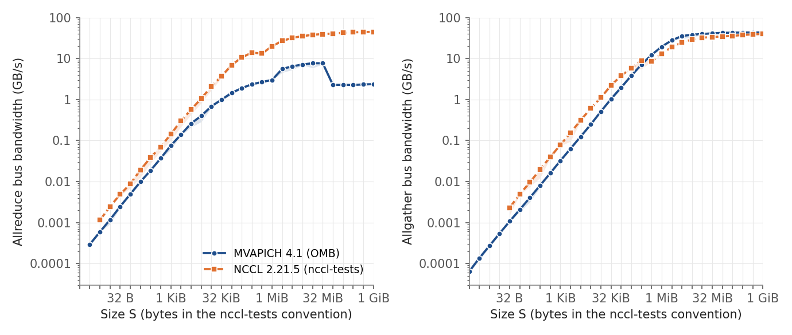
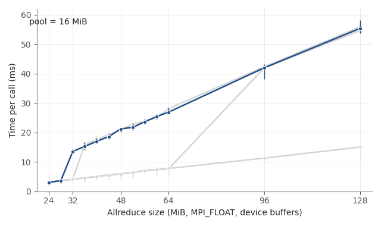
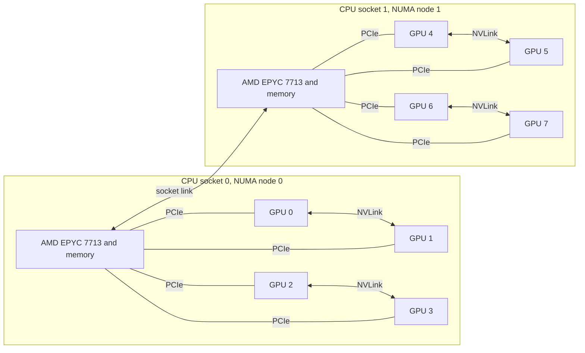

# GPU-aware MPI and NCCL on an 8-GPU RTX A6000 node

I measured CUDA-aware MVAPICH 4.1 with the OSU Micro-Benchmarks against NCCL on one server with 8 NVIDIA RTX A6000 GPUs, and
followed up on an allreduce slowdown and on data corruption over PCIe peer-to-peer.

## Results

1. Between two NVLink-bridged GPUs, `osu_bw` reached 52,872 MB/s at 1 GiB on the MVAPICH default path, which uses CUDA IPC.
   With CUDA IPC turned off in UCX, so that the data went through host memory, it reached 23,058 MB/s. Both are medians of
   5 runs. Source: [`data/p2p_summary.csv`](data/p2p_summary.csv), logs in [`raw/p2p/`](raw/p2p) and [`raw/ucx/`](raw/ucx).
2. With device buffers, the allreduce slowed sharply between 32 and 36 MiB, from 4,079.89 to 15,784.26 microseconds per call.
   The point moves with `MPIR_CVAR_LMEM_POOL_SIZE`: raising it from 32 to 128 MiB made a 128 MiB allreduce 3.7 times faster
   (55,879.78 to 15,026.16 microseconds). The variable has an MPICH-style name, but MVAPICH defines it. It sizes the pool that
   the MPICH-derived allreduce path in MVAPICH 4.1 uses for its temporary buffers. Source:
   [`data/allreduce_sweep.csv`](data/allreduce_sweep.csv), [`data/allreduce_knobs.csv`](data/allreduce_knobs.csv),
   [`raw/verify/lmem_pool_source.txt`](raw/verify/lmem_pool_source.txt); details in
   [docs/allreduce_slowdown.md](docs/allreduce_slowdown.md).
3. A 64 MiB CUDA peer copy across PCIe between GPUs 3 and 4, which are not NVLink partners, returned 16,777,216 wrong words out
   of 16,777,216. The same copy between the NVLink partners 2 and 3 was correct. Source:
   [`raw/p2p_probe/probe_3_4_dma.log`](raw/p2p_probe/probe_3_4_dma.log),
   [`raw/p2p_probe/probe_2_3_dma.log`](raw/p2p_probe/probe_2_3_dma.log); details and a warning in
   [docs/p2p_corruption.md](docs/p2p_corruption.md).



*Bus bandwidth on GPUs 2 and 3: median of 5 runs, with the band from minimum to maximum. MVAPICH's allreduce drops between 32
and 64 MiB in this OMB sweep, while its allgather stays close to NCCL.*



*Allreduce time on GPUs 2 and 3 while `MPIR_CVAR_LMEM_POOL_SIZE` steps through 16, 32, 64 and 128 MiB. The slowdown follows the
dashed line at the pool size.*

Other figures: [`figures/osu_bw.png`](figures/osu_bw.png) and [`figures/allreduce_pool.png`](figures/allreduce_pool.png).
[`docs/interactive.html`](docs/interactive.html) is one chart in which you pick the benchmark and the GPU path. It has no
external dependencies: download it and open it in a browser, or serve the repository with GitHub Pages.

## Setup



Every GPU has its own PCIe link to its CPU socket. Traffic between GPUs that are not NVLink partners goes over PCIe through the
CPUs, and across sockets it also crosses the socket link.

| part | version or value | source |
|---|---|---|
| GPUs | 8 x NVIDIA RTX A6000, 49140 MiB each, PCIe Gen4 x16 | `raw/env/nvidia-smi_q.txt` |
| CPUs | 2 x AMD EPYC 7713 | `raw/env/lscpu.txt` |
| OS | Ubuntu 24.04.5 LTS, kernel 7.0.0-38-generic | `raw/env/os_driver.txt` |
| driver and CUDA | NVIDIA driver 580.178.04, CUDA toolkit 12.4 | `raw/env/nvidia-smi.txt`, `raw/env/cuda_12.4.txt` |
| UCX | 1.22.0, built with `--with-cuda` and without verbs or gdrcopy | `scripts/build_ucx.sh` |
| MVAPICH | 4.1, based on MPICH 4.3.0, built with `--with-device=ch4:ucx`, `--with-cuda` and `--with-pm=gforker` | `scripts/build_mvapich.sh` |
| OSU Micro-Benchmarks | 7.5.3, built with `--enable-cuda` | `scripts/build_omb.sh` |
| NCCL | 2.21.5, from the `nvidia-nccl-cu12` wheel | `raw/env/python_torch_nccl.txt` |
| nccl-tests | 2.21.1, built with `MPI=1` | `scripts/build_nccl_tests.sh` |

I built everything without root; [docs/build.md](docs/build.md) has every flag, the problems I hit, and the checks that the
build is CUDA-aware.

## MPI and NCCL on one NVLink pair

GPUs 2 and 3, medians of 5 runs. S is the size in the nccl-tests convention, and bus bandwidth is defined as in nccl-tests.

| S | collective | MVAPICH time (µs) | NCCL time (µs) | MVAPICH bus bandwidth (GB/s) | NCCL bus bandwidth (GB/s) |
|---|---|---|---|---|---|
| 8 KiB | allreduce | 20.49 | 7.73 | 0.40 | 1.06 |
| 8 KiB | allgather | 16.59 | 6.74 | 0.25 | 0.61 |
| 1 MiB | allreduce | 346.9 | 52.25 | 3.02 | 20.07 |
| 1 MiB | allgather | 26.87 | 40.05 | 19.51 | 13.09 |
| 256 MiB | allreduce | 117,960 | 6,143 | 2.28 | 43.70 |
| 256 MiB | allgather | 3,099 | 3,557 | 43.32 | 37.73 |

NCCL took less time for allreduce at all three sizes. MVAPICH took less time for allgather at 1 MiB and 256 MiB. Spreads,
reduce_scatter and the 4-GPU results are in [`data/mpi_vs_nccl_table.csv`](data/mpi_vs_nccl_table.csv) and
[`data/tables.md`](data/tables.md).

## Why these results can be trusted

* Correctness came before speed. Every OMB configuration passed a validation sweep with `-c` (one 4-GPU sweep stopped after
  its 512 MiB size had passed), and every nccl-tests run reported 0 wrong results
  ([`data/validation_summary.csv`](data/validation_summary.csv), [`data/nccl_wrong_summary.csv`](data/nccl_wrong_summary.csv)).
* Each point is the median of 5 runs in shuffled order, and the files keep the minimum and maximum.
* I confirmed the transport instead of assuming it. The UCX logs show `cuda_ipc` for the NVLink runs with CUDA IPC and staging
  through host memory for the others ([`data/ucx_protocol_selection.md`](data/ucx_protocol_selection.md)).
* I tested the slowdown against other explanations. All 9 allreduce algorithms that I could force show it, host buffers show it
  at the same size, and it moves with the pool size ([`data/allreduce_cliff_algo.csv`](data/allreduce_cliff_algo.csv),
  [`data/allreduce_cliff_sweep.csv`](data/allreduce_cliff_sweep.csv), [`data/allreduce_cliff_knobs.csv`](data/allreduce_cliff_knobs.csv)).
  I committed the follow-up's hypotheses at 23:18:16 EST on 2026-11-12 and its data at 23:49:19 EST the same day.
* An Nsight Systems trace shows where the data goes during one allreduce ([`data/allreduce_nsys.csv`](data/allreduce_nsys.csv)).
* The findings are consistent with independent sources: NVIDIA's documentation on IOMMU and PCIe peer-to-peer
  ([CUDA Programming Guide, section 3.4.2.5](https://docs.nvidia.com/cuda/cuda-programming-guide/03-advanced/multi-gpu-systems.html#host-iommu-hardware-pci-access-control-services-and-vms)),
  the [MVAPICH 4.1 user guide](https://mvapich-docs.readthedocs.io/en/open-v4.1/cvar.html#mpir-cvar-lmem-pool-size) and
  [changelog](https://mvapich.cse.ohio-state.edu/static/media/mvapich/MVP-4.1-CHANGELOG.txt), and the
  [MPICH 4.3.0 source](https://github.com/pmodels/mpich/blob/v4.3.0/src/include/mpir_mem.h) for the temporary-buffer allocation.
* What I could not check: the kernel log and the PCIe ACS bits need root, and I tested the slowdown only with `MPI_FLOAT` on
  2 ranks.

[docs/method.md](docs/method.md) has the full version of this list, with sections and files for each point.

## Limits

* One node only.
* Only the open-source MVAPICH 4.1, whose changelog lists basic GPU support. I did not test MVAPICH-Plus.
* The InfiniBand ports were down, so there are no GPUDirect RDMA or inter-node results.
* The cause of the peer-to-peer corruption is strongly supported but not proven.
* The mechanism of the allreduce slowdown is my reading of the evidence.
* The machine was shared: another user's jobs ran on GPUs 0 and 1 during all my measurements.

## An open question

The profile suggests that MVAPICH 4.1 stages GPU reductions by sending half of the data through a pageable host buffer, and that
above the pool size this buffer is allocated again on every call. Is this how MVAPICH 4.1 is meant to work, and does
MVAPICH-Plus avoid it?

## Reproduce

```bash
pip install -r requirements.txt
python3 scripts/analyze.py
python3 scripts/analyze_allreduce.py sweep knobs algo glibc gpu_time
python3 scripts/plot.py
```

These rebuild `data/` and `figures/` from the logs without a GPU. [docs/build.md](docs/build.md) explains the builds, and
[docs/reproduce.md](docs/reproduce.md) lists the exact commands to rerun the measurements. Read
[docs/p2p_corruption.md](docs/p2p_corruption.md) before running anything on a shared machine.

## License and citation

The code and documentation are under the MIT License ([LICENSE](LICENSE)). To cite this work:

```bibtex
@misc{keivanimehr_gpu_mpi_osu_a6000,
  author       = {Mehran Keivanimehr},
  title        = {GPU-aware MPI and NCCL on an 8-GPU RTX A6000 node},
  year         = {2026},
  howpublished = {\url{https://github.com/MehranKeivanimehr/gpu-mpi-osu-a6000}}
}
```
